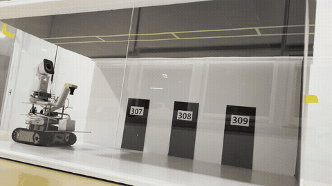
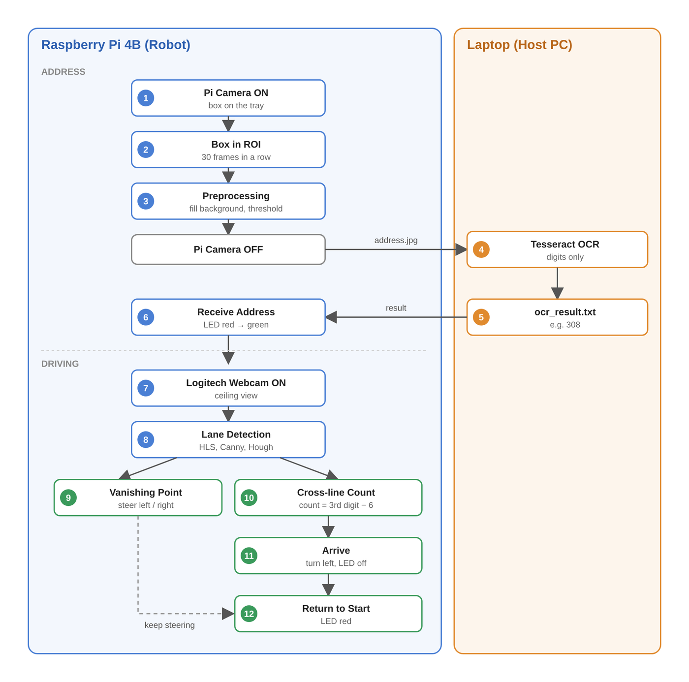
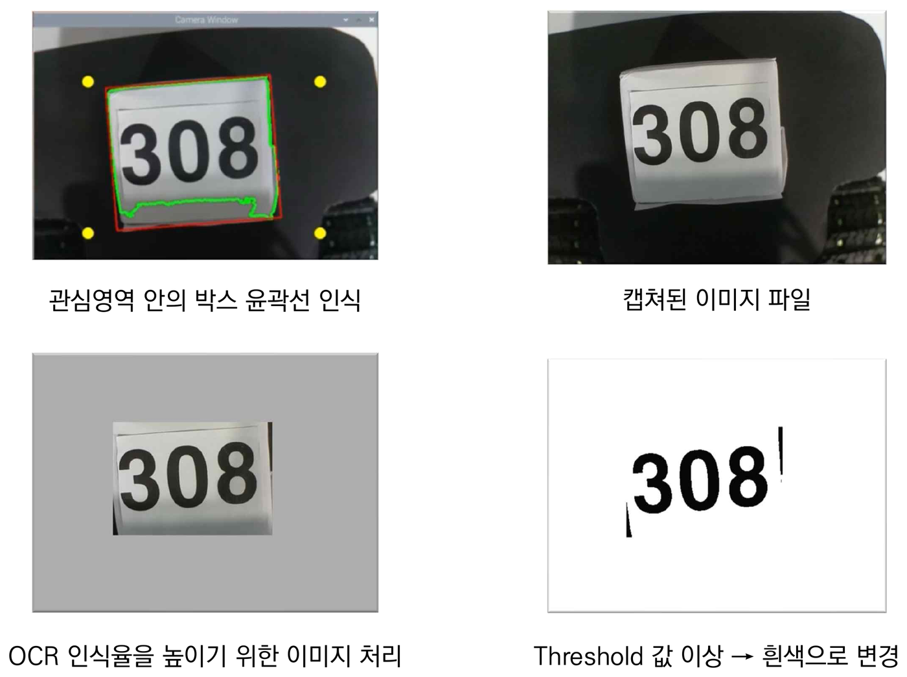
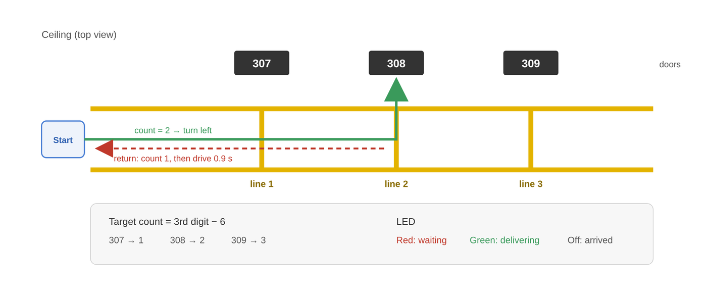
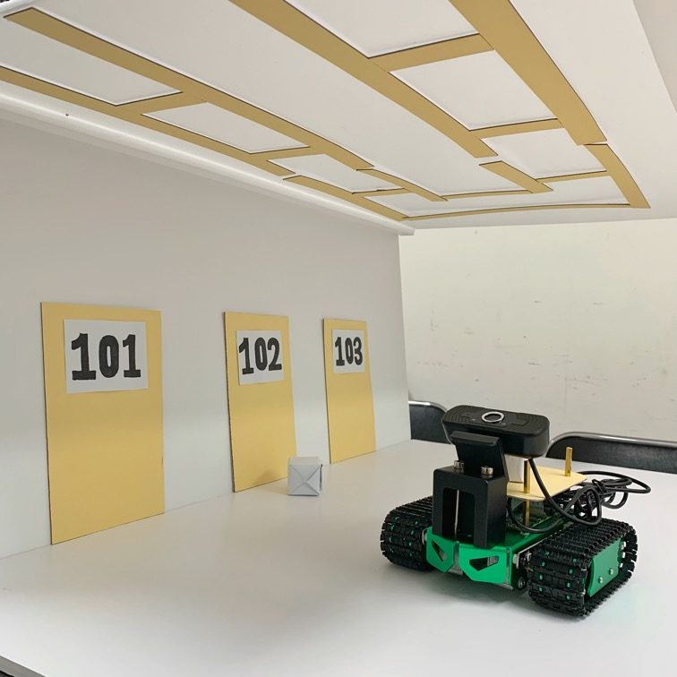

# 건물 내 택배 배달 로봇 (BOOTV5)

2022 제14회 창의설계경진대회 (건국대학교 전기전자공학부)

상자에 적힌 호수를 카메라로 읽고, 건물 안에서 그 호실 앞까지 택배를 옮긴 뒤 출발점으로 돌아오는 로봇입니다.
길은 **천장에 그린 노란 차선**으로 찾고, 호실은 차선 사이에 그은 **가로선 개수**로 구분합니다.

<p align="center">
  
</p>

<p align="center"><sub>308호 배달 시연 (6배속)</sub></p>

## 핵심 아이디어

- **천장 차선**: 바닥 라인은 사람이나 짐에 가려지기 쉽고 미관도 해칩니다. 그래서 라인을 천장에 그렸습니다. 복도 천장을 올려다보면 양쪽 차선이 멀리서 한 점(소실점)으로 모이는데, 이 점이 화면 가운데에 오도록 방향을 잡습니다.
- **자체 주소 체계**: 건물 지도를 만드는 대신 차선 사이에 호실마다 가로선을 하나씩 그었습니다. 가로선을 몇 개 지났는지 세면 지금 어느 호실 앞인지 알 수 있습니다.

## 시스템 흐름

라즈베리파이 카메라가 먼저 상자를 찍고, 노트북에서 읽은 호수가 돌아오면 그때 천장을 보는 웹캠이 켜집니다.

<p align="center">
  
</p>

### 1. 주소 인식

| 단계 | 기기 | 하는 일 |
| --- | --- | --- |
| 상자 감지 | Raspberry Pi | 관심 영역 안에 상자가 30프레임 넘게 연속으로 잡히면 사진을 찍음 |
| 이미지 처리 | Raspberry Pi | 상자 바깥을 회색으로 칠하고 이진화해서 호수 숫자만 검게 남김 → `address.jpg` |
| 사진 전송 | Raspberry Pi → Laptop | TCP 소켓으로 `address.jpg` 전송 |
| 문자 인식 | Laptop | Tesseract OCR로 읽고 숫자만 뽑아 `ocr_result.txt` 저장 |
| 결과 전송 | Laptop → Raspberry Pi | TCP 소켓으로 `ocr_result.txt` 전송 |

<p align="center">
  
</p>

### 2. 주행

- 웹캠 영상을 HLS로 바꿔 흰색과 노란색만 남긴 뒤, 흑백 변환 → 가우시안 블러 → Canny 엣지 → 관심 영역 → 허프 변환 순서로 직선을 찾습니다.
- 기울기 4°~86°인 직선은 차선 후보, 4° 미만인 직선은 가로선 후보로 나눕니다.
- 차선 후보들의 교점 중 다른 직선들과 가장 가까운 점을 소실점으로 고르고, 화면 가운데 ±30px 안이면 직진, 벗어나면 반대쪽 바퀴를 잠깐 돌려 방향을 고칩니다.
- 가로선이 안 보이다가 220px 넘는 가로선이 처음 보일 때만 개수를 하나 올립니다.

<p align="center">
  
</p>

| 동작 | 조건 |
| --- | --- |
| 목적지 도착 | 가로선 개수 = 호수 셋째 자리 − 6 (307 → 1, 308 → 2, 309 → 3) |
| 도착 후 | 왼쪽으로 돌아 문을 마주 보고 3초 정지, 다시 왼쪽으로 돌아 0.5초 후진 |
| 복귀 완료 | 가로선 개수 = 셋째 자리 − 7 이 되면 0.9초 직진 후 정지 |

| LED | 의미 |
| --- | --- |
| 빨강 | 상자를 기다리는 중, 또는 복귀 완료 |
| 초록 | 배달하는 중 |
| 둘 다 꺼짐 | 호실 앞에 도착 |

## 하드웨어

| 구성 | 사용 부품 |
| --- | --- |
| 제어 보드 | Raspberry Pi 4 Model B 8GB |
| 상자 인식 카메라 | Raspberry Pi 전용 카메라 모듈 |
| 천장 인식 카메라 | 로지텍 USB 웹캠 |
| 모터 드라이버 | L298N |
| 구동부 | DC 모터 2개, 궤도형 차체 |
| 표시등 | LED 2개 (빨강, 초록) |
| OCR 처리 | Windows 노트북 (Tesseract-OCR) |

<details>
<summary>GPIO 핀 배치 (BCM 번호)</summary>

| 연결 | 핀 |
| --- | --- |
| 왼쪽 모터 속도 (ENA) | 25 |
| 왼쪽 모터 방향 (IN1, IN2) | 23, 24 |
| 오른쪽 모터 속도 (ENB) | 22 |
| 오른쪽 모터 방향 (IN3, IN4) | 17, 27 |
| LED (빨강, 초록) | 16, 26 |

</details>

<p align="center">
  
</p>

## 폴더 구조

```
.
├── raspberry_pi/          # 로봇(라즈베리파이)에서 실행
│   ├── main.py            # 주소 받기 + 주행 전체 흐름
│   ├── box_capture.py     # 상자 캡처와 이미지 처리
│   ├── echo_client.py     # address.jpg 보내기
│   ├── server_only.py     # ocr_result.txt 받기
│   ├── motor_control.py   # DC 모터 제어 함수
│   ├── config.py          # 노트북, 라즈베리파이 IP와 포트
│   └── requirements.txt
├── laptop/                # 노트북에서 실행
│   ├── main.py            # 받기 → OCR → 보내기
│   ├── echo_server.py     # address.jpg 받기
│   ├── ocr_tesseract.py   # Tesseract로 호수 읽기
│   ├── echo_client.py     # ocr_result.txt 보내기
│   ├── config.py          # IP, 포트, Tesseract 설치 경로
│   └── requirements.txt
└── docs/images/           # README 그림
```

기능별 실습 코드(차선 인식, OCR, 소켓 테스트 등)는 [Practice-capstone](https://github.com/yoosk526/Practice-capstone) 저장소에 있습니다.

## 실행 방법

1. 노트북 모바일 핫스팟에 라즈베리파이를 연결하고, 두 기기의 IP를 확인해 `raspberry_pi/config.py`와 `laptop/config.py`에 똑같이 적습니다.
2. 노트북에 [Tesseract-OCR](https://github.com/tesseract-ocr/tesseract)을 설치하고, 설치 경로를 `laptop/config.py`의 `TESSERACT_CMD`에 적습니다.
3. 각 기기에서 필요한 패키지를 설치합니다.
   ```bash
   pip install -r requirements.txt
   ```
4. **노트북을 먼저** 실행합니다. 사진을 받을 서버가 먼저 기다리고 있어야 합니다.
   ```bash
   cd laptop
   python main.py
   ```
5. 라즈베리파이를 실행하면 빨간 LED가 켜집니다. 상자를 올리면 호수를 읽고 출발합니다.
   ```bash
   cd raspberry_pi
   python3 main.py
   ```

## 한계

- 호수 셋째 자리만 보기 때문에 한 층의 세 호실(307~309호)만 구분합니다.
- 제자리 회전과 복귀 마지막 구간을 시간으로 제어해서, 배터리 잔량이나 바닥 상태에 따라 멈추는 위치가 달라질 수 있습니다.
- 흰 바탕에 크게 적은 숫자만 시험했고, 글자가 많은 실제 운송장은 시험하지 않았습니다.
- 라즈베리파이와 노트북이 같은 네트워크에 있어야 하고, IP를 설정 파일에 직접 적어야 합니다.
- 코드는 2022년 당시 환경(Python 3.7~3.10, NumPy 1.x) 기준이라 최신 NumPy에서는 `np.int0`를 `np.intp`로 바꿔야 할 수 있습니다.

## 팀

| 이름 | 역할 |
| --- | --- |
| 유승권 | 팀장, 주행 (차선 인식, 소실점, 가로선 카운트, 모터, LED) |
| 김윤주 | 주행 (차선 인식, 소실점, 가로선 카운트, 모터, LED) |
| 강수현 | 주소 인식, 통신 (상자 캡처, OCR, 소켓) |
| 최은빈 | 주소 인식, 통신 (상자 캡처, OCR, 소켓) |

지도교수: 조용범 교수님
